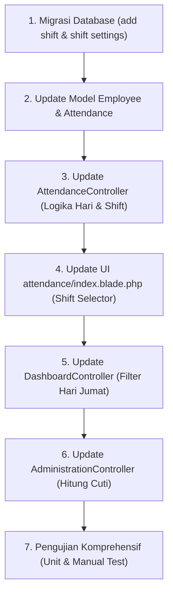

# Spesifikasi Teknis: Fitur Shift Khusus Satpam & Penyesuaian Hari Kerja Non-ASN
### Kantor Wilayah Kementerian Hukum dan HAM Kepulauan Bangka Belitung

---

## 📌 1. Ringkasan Eksekutif & Aturan Bisnis

Berdasarkan hasil diskusi, sistem presensi dan monitoring evaluasi (Monev) akan mengadopsi 2 aturan operasional khusus:

| Komponen | Satpam | Pegawai Non-ASN Lain (Driver, Kebersihan, dll.) |
| :--- | :--- | :--- |
| **Hari Kerja Wajib** | **Senin – Jumat** (5 Hari Kerja) | **Senin – Kamis** (4 Hari Kerja) |
| **Hari Libur Rutin** | Sabtu & Minggu | Jumat, Sabtu, & Minggu |
| **Sistem Shift** | **Ya, 2 Shift** (Shift Pagi & Shift Malam) | **Tidak Ada Shift** (Jam Kantor Standar) |
| **Pilihan Shift di UI**| Muncul *Prompt / Select Card* | Tidak muncul (otomatis jam normal) |

---

## ⏰ 2. Standar Jam Kerja & Pembagian Shift

### A. Non-ASN Reguler (Senin – Kamis)
* **Hari Aktif:** Senin, Selasa, Rabu, Kamis.
* **Jam Masuk:** 06.00 – 08.00 WIB (Batas tepat waktu: 08.00 WIB).
* **Jam Pulang:** Mulai 16.00 WIB.

### B. Satpam / Tenaga Pengamanan (Senin – Jumat)
* **Hari Aktif:** Senin, Selasa, Rabu, Kamis, Jumat.
* **Sesi Shift:**
  1. ☀️ **Shift Pagi (Dinas Siang):**
     * **Jam Masuk:** 06.30 – 08.00 WIB (Batas tepat waktu: 08.00 WIB).
     * **Jam Pulang:** Mulai 19.00 WIB.
  2. 🌙 **Shift Malam (Dinas Malam - Lintas Hari):**
     * **Jam Masuk:** 18.30 – 20.00 WIB (Batas tepat waktu: 20.00 WIB).
     * **Jam Pulang:** Mulai 07.00 WIB (Keesokan harinya).

---

## 🗄️ 3. Perubahan Skema Database

### Migrasi: `add_shift_and_workdays_settings`
Menambahkan kolom pelacakan shift pada tabel `attendances` dan konfigurasi shift di `office_settings`:

```php
// database/migrations/2026_11_25_000001_add_shift_to_attendances_table.php

use Illuminate\Database\Migrations\Migration;
use Illuminate\Database\Schema\Blueprint;
use Illuminate\Support\Facades\Schema;

return new class extends Migration {
    public function up(): void
    {
        Schema::table('attendances', function (Blueprint $table) {
            $table->enum('shift', ['pagi', 'malam'])->nullable()->after('employee_id');
        });

        Schema::table('office_settings', function (Blueprint $table) {
            // Jam Shift Pagi Satpam
            $table->time('satpam_pagi_in_start')->default('06:30:00')->after('check_out_start');
            $table->time('satpam_pagi_in_end')->default('08:00:00')->after('satpam_pagi_in_start');
            $table->time('satpam_pagi_out_start')->default('19:00:00')->after('satpam_pagi_in_end');

            // Jam Shift Malam Satpam
            $table->time('satpam_malam_in_start')->default('18:30:00')->after('satpam_pagi_out_start');
            $table->time('satpam_malam_in_end')->default('20:00:00')->after('satpam_malam_in_start');
            $table->time('satpam_malam_out_start')->default('07:00:00')->after('satpam_malam_in_end');
        });
    }

    public function down(): void
    {
        Schema::table('attendances', function (Blueprint $table) {
            $table->dropColumn('shift');
        });

        Schema::table('office_settings', function (Blueprint $table) {
            $table->dropColumn([
                'satpam_pagi_in_start', 'satpam_pagi_in_end', 'satpam_pagi_out_start',
                'satpam_malam_in_start', 'satpam_malam_in_end', 'satpam_malam_out_start'
            ]);
        });
    }
};
```

---

## 🧠 4. Arsitektur & Logika Backend (Laravel Best Practice)

### A. Helper Validasi Hari Kerja per Role
Membuat logika terpusat pada Model `Employee` atau Trait:

```php
// app/Models/Employee.php

public function isWorkDay(Carbon $date): bool
{
    $dayOfWeek = $date->dayOfWeek; // 0 (Minggu) s/d 6 (Sabtu)

    if ($this->role?->name === 'Satpam') {
        // Satpam: Senin (1) s/d Jumat (5)
        return in_array($dayOfWeek, [Carbon::MONDAY, Carbon::TUESDAY, Carbon::WEDNESDAY, Carbon::THURSDAY, Carbon::FRIDAY]);
    }

    // Non-ASN Lain: Senin (1) s/d Kamis (4)
    return in_array($dayOfWeek, [Carbon::MONDAY, Carbon::TUESDAY, Carbon::WEDNESDAY, Carbon::THURSDAY]);
}
```

---

### B. Penanganan Kasus Lintas Hari (Overnight Shift Malam)
Di `AttendanceController.php`, saat Satpam membuka halaman presensi di pagi hari (misal Selasa jam 07.00), sistem harus mengecek apakah ada **Shift Malam kemarin yang belum Absen Pulang**:

```php
// app/Http/Controllers/AttendanceController.php

public function index()
{
    $user = auth()->user();
    $today = Carbon::today()->toDateString();
    $yesterday = Carbon::yesterday()->toDateString();
    $office = OfficeSetting::getActive();
    $isSatpam = $user->employee?->role?->name === 'Satpam';

    // 1. Cek apakah ada tugas Shift Malam kemarin yang belum Absen Pulang
    $attendance = null;
    if ($isSatpam) {
        $yesterdayNightShift = Attendance::where('user_id', $user->id)
            ->whereDate('date', $yesterday)
            ->where('shift', 'malam')
            ->whereNull('check_out_time')
            ->first();

        if ($yesterdayNightShift) {
            $attendance = $yesterdayNightShift; // Ikat ke shift malam kemarin untuk absen pulang
        }
    }

    // 2. Jika tidak ada pending shift malam kemarin, cari absensi hari ini
    if (!$attendance) {
        $attendance = Attendance::where('user_id', $user->id)
            ->whereDate('date', $today)
            ->first();
    }

    // 3. Validasi Hari Kerja
    $isWorkDayToday = $user->employee ? $user->employee->isWorkDay(Carbon::now()) : true;

    return view('attendance.index', compact(
        'title', 'active', 'user', 'attendance', 'office', 'today', 'isSatpam', 'isWorkDayToday'
    ));
}
```

---

### C. Validasi Jam Masuk & Penentuan Status (Tepat Waktu / Terlambat)
Saat `checkIn` dipanggil:

```php
// Menentukan jam batas masuk berdasarkan role dan shift
if ($isSatpam && $request->shift === 'malam') {
    $limitTime = Carbon::parse($office->satpam_malam_in_end ?? '20:00:00');
} elseif ($isSatpam && $request->shift === 'pagi') {
    $limitTime = Carbon::parse($office->satpam_pagi_in_end ?? '08:00:00');
} else {
    $limitTime = Carbon::parse($office->check_in_end ?? '08:00:00');
}

$now = Carbon::now();
$checkInStatus = $now->gt($limitTime) ? 'terlambat' : 'tepat_waktu';
```

---

### D. Penyesuaian Perhitungan Cuti (`AdministrationController`)
Perhitungan `lama_hari_cuti` disesuaikan dengan role:
* **Satpam:** Mengabaikan Sabtu dan Minggu.
* **Driver & Kebersihan:** Mengabaikan **Jumat, Sabtu, dan Minggu**.

```php
// app/Http/Controllers/AdministrationController.php

$workDaysCount = 0;
for ($date = $start->copy(); $date->lte($end); $date->addDay()) {
    if ($user->employee && $user->employee->isWorkDay($date)) {
        $workDaysCount++;
    }
}
```

---

### E. Penyesuaian Rekap Harian di Dashboard Admin (`DashboardController`)
Pada hari Jumat:
* Satpam tetap terhitung sebagai karyawan wajib masuk.
* Driver dan Petugas Kebersihan **tidak dicap sebagai Alpha/Tanpa Keterangan**, melainkan dikelompokkan ke dalam kategori **"Libur Terjadwal (Off Dinas)"**.

---

## 🎨 5. Desain Komponen Frontend (Tailwind CSS)

### Select Card Pilihan Shift (Hanya Tampil untuk Satpam)
Ditempatkan tepat di atas area kamera dengan styling modern Tailwind yang konsisten dengan desain aplikasi:

```html
@if($isSatpam && (!$attendance || !$attendance->check_in_time))
    <div class="mb-4 bg-gradient-to-br from-indigo-50 to-blue-50 border border-indigo-200 rounded-xl p-4 shadow-sm">
        <label class="block text-xs font-bold text-indigo-900 mb-2 uppercase tracking-wider flex items-center gap-1.5">
            <svg class="size-4 text-indigo-600" fill="none" stroke="currentColor" viewBox="0 0 24 24">
                <path stroke-linecap="round" stroke-linejoin="round" stroke-width="2" d="M12 8v4l3 3m6-3a9 9 0 11-18 0 9 9 0 0118 0z" />
            </svg>
            Pilih Shift Tugas Jaga Hari Ini <span class="text-rose-500">*</span>
        </label>

        <div class="grid grid-cols-2 gap-3">
            <!-- Option Shift Pagi -->
            <label class="relative flex flex-col p-3 border-2 rounded-xl cursor-pointer transition hover:bg-white has-[:checked]:border-indigo-600 has-[:checked]:bg-white has-[:checked]:shadow-md">
                <input type="radio" name="shift_select" value="pagi" class="sr-only" onchange="selectShift('pagi')" checked>
                <div class="flex items-center gap-2 mb-1">
                    <span class="p-1.5 rounded-lg bg-amber-100 text-amber-600">
                        ☀️
                    </span>
                    <span class="text-sm font-bold text-gray-800">Shift Pagi</span>
                </div>
                <span class="text-[11px] text-gray-500">06.30 - 19.00 WIB</span>
            </label>

            <!-- Option Shift Malam -->
            <label class="relative flex flex-col p-3 border-2 rounded-xl cursor-pointer transition hover:bg-white has-[:checked]:border-indigo-600 has-[:checked]:bg-white has-[:checked]:shadow-md">
                <input type="radio" name="shift_select" value="malam" class="sr-only" onchange="selectShift('malam')">
                <div class="flex items-center gap-2 mb-1">
                    <span class="p-1.5 rounded-lg bg-indigo-100 text-indigo-600">
                        🌙
                    </span>
                    <span class="text-sm font-bold text-gray-800">Shift Malam</span>
                </div>
                <span class="text-[11px] text-gray-500">18.30 - 07.00 WIB (Lintas Hari)</span>
            </label>
        </div>
    </div>
@endif
```

---

## 🚀 6. Rencana Implementasi Bertahap



Spesifikasi ini dirancang agar bersih, modular, dan tidak merusak fitur-fitur yang sudah berjalan stabil sebelumnya.
